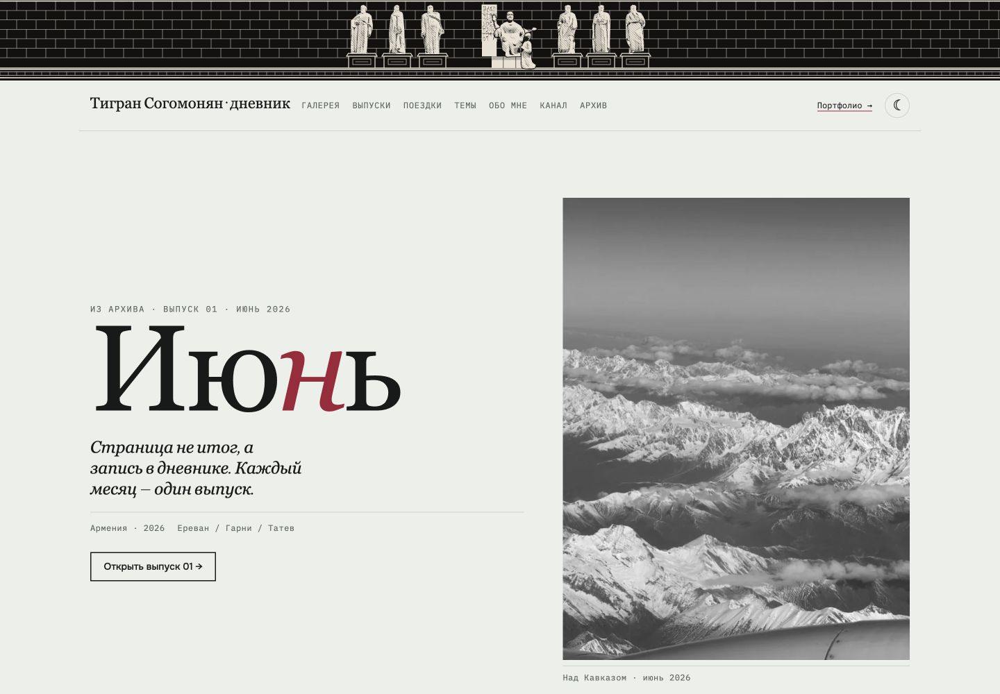
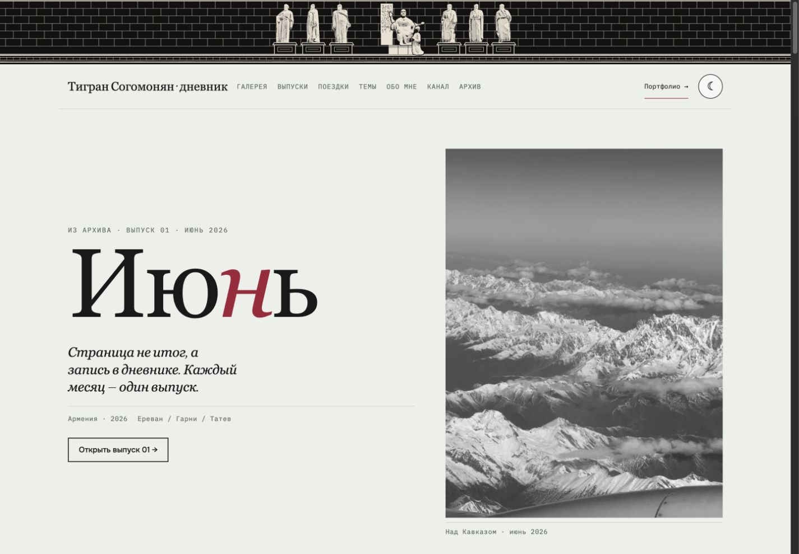
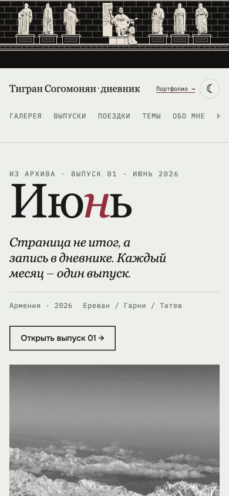
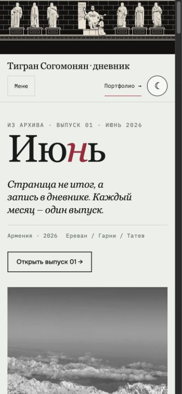

# Diary — Editorial Refinement & Quality Assurance

Дата: 3 ноября 2026. Ветка: `improve-editorial-ux-2026-11`. PR: https://github.com/TigranSogomonyan/diary/pull/1.

Исходная точка: `f4b01581b9970e864b55a0cada46283a58794e28` — актуальная вершина PR #1 перед этой работой. Существующие изменения PR сохранены. `main` не изменён, PR не объединён, GitHub Pages не перевыкладывался.

## Исправления

| Проблема | Что изменено |
|---|---|
| Мобильная навигация скрывала часть разделов в горизонтальной полосе | Кнопка меню, перенос ссылок, Escape, закрытие после выбора; фокус переходит в выбранный раздел. Якорный отступ учитывает фактическую высоту шапки. |
| Разные масштабы кнопок и слабая связность секций | Единый вертикальный ритм, межстрочные интервалы заголовков, метаданные и подписи галереи; основные управляющие кнопки от 44 px. |
| Абсолютно размещённое фото обложки мешало компактным карточкам | Обложка стала частью потока карточки; опубликованный и готовящиеся номера сохраняют общую сетку. |
| После изменения ширины читалка сохраняла старую разметку | Перестройка 12 мобильных страниц / 6 десктопных разворотов с сохранением текущего места. При переходе к развороту сохраняется содержащая страницу пара. |
| Фон модального окна оставался интерактивным | `inert`, удержание Tab/Shift+Tab, возврат фокуса без скачка прокрутки. Исправлена обработка фокуса на ставшей недоступной кнопке. |
| Клавиши стрелок могли также прокручивать страницу | Предотвращено стандартное действие; добавлены Home/End. Нативная горизонтальная прокрутка и scroll-snap сохранены. |
| Стрелки карусели исчезали на телефоне | Видны и доступны на всех ширинах, состояние на краях сохранено. |
| Часть карточек архива выходила за доску | Ограничение с учётом поворота и размеров после загрузки/resize; отступ при перетаскивании и клавиатурном перемещении. Прокрутка страницы разрешена между карточками. |
| Полноширинная сетка учитывала полосу прокрутки как доступную ширину | Ширина через контейнерные единицы; нет горизонтального переполнения. |
| Небольшие подписи в трёх колонках теснились | Адаптированы кегль, переносы, расположение закрытия и метаданных; увеличены кнопки плотности. |
| Доступное имя кнопки номера расходилось с видимым текстом | Кнопка использует собственный видимый текст без заменяющего aria-label. Дополнительная проверка Lighthouse теперь проходит. |
| Критический HTML содержал большой SVG-орнамент | Верхний/нижний SVG вынесены в `assets/`; общий паттерн скопирован в верхний файл, все ссылки внутри SVG замкнуты. Размер HTML: 419 791 → 114 887 байт, −72,6%. |
| Нижний архив конкурировал с первым экраном за сеть | Lazy loading фото архива/обложки/нижнего SVG, `defer` внешних скриптов; Noto подгружается только для используемых инициалов глав. |
| В опубликованном выпуске была внутренняя служебная пометка | Удалено только «— место для строки из манифеста»; сама цитата сохранена. |

Палитра, оригиналы `f/`, логотип/монограмма и написание имени сохранены. Новых материалов Тбилиси и новых анимаций нет. В общих стилях `prefers-reduced-motion` отключает переходы, анимации и плавную прокрутку; отдельная эмуляция системного режима в браузере не выполнялась.

## Проверки

Реальный встроенный браузер Codex: главная, Ереван, Тбилиси × 320 / 390 / 768 / 1024 / 1440 px × светлая/тёмная темы. **30 из 30** проверок ширины/темы пройдены; таблица измерений в [viewport-results.json](viewport-results.json). Допустимая горизонтальная прокрутка осталась только внутри галереи и читалки.

Через интерфейс с проверкой состояния и assert:

- Открытие и закрытие июньского номера, недоступность фона, начальный фокус, возврат фокуса, Shift+Tab по кругу.
- Стрелки, Home/End, блокировка кнопок на границах; горизонтальный жест прокрутки перевёл `1 / 12` в `2 / 12`.
- Переход 390 → 1024 при открытом выпуске: `12 / 12` → `6 / 6`, без потери страниц.
- Мобильное меню: открытие, Escape, выбор раздела и фокус на нём.
- «Архитектура / Природа»: ArrowRight/Home, состояния вкладок и панелей; плотности 2/3.
- Открытие/закрытие подписи кадра, возврат к кнопке кадра.
- Архив: фильтр «Заметки» оставляет две доступные карточки, возврат «Все», движение стрелкой и перетаскивание указателем.
- Стрелка карусели меняет фактическую прокрутку; кнопки блокируются на краях.
- Тёмная тема сохраняется при переходе в Ереван и обратно; карусель слов/фото Еревана переходит к `2 / 4`.
- Целевые страницы Diary и Portfolio доступны; на Portfolio присутствует правильная обратная ссылка «Дневник ↗». Ссылки открываются в новой вкладке, поведение оставлено прежним.
- В просмотренных состояниях консоль без ошибок и предупреждений.

Статическая проверка `python3 qa/check.py`: **4 HTML, 87 локальных ссылок/ресурсов, 11 JS-блоков/файлов**, уникальность ID, один main/h1, `noopener`, корректный XML и внутренние ссылки SVG. `git diff --check` проходит. Скрипт не требует установки пакетов или сборки.

## Lighthouse

Lighthouse 13.6.0, отдельный headless Google Chrome, локальный Python HTTP-сервер **без сжатия и production-кеширования**, чистые профили. Мобильный пресет — стандартная симуляция медленной сети/CPU Lighthouse; десктоп — `--preset=desktop`. Сравнивалась исходная версия PR и итоговый код в одинаковом типе сервера. Точные настройки и значения: [lighthouse-results.json](lighthouse-results.json).

| Показатель | Mobile до → после | Desktop до → после |
|---|---|---|
| Performance | 65 → **77** | 96 → **100** |
| Accessibility | 100 → **100** | 100 → **100** |
| LCP | 8,67 → **5,26 с** | 0,88 → **0,73 с** |
| CLS | 0 → **0** | 0,104 → **0,003** |
| TBT | 0 → **0 мс** | 0 → **0 мс** |

Это лабораторные одиночные замеры, а не полевые Core Web Vitals. Мобильный LCP ещё выше целевых 2,5 с. Эффект production-сжатия, CDN, реальной мобильной сети и кеша нужно измерять после разрешённой публикации; зависимости от Google Fonts сохранены.

Воспроизведение:

```sh
python3 -m http.server 8765 --bind 127.0.0.1 --directory ..
lighthouse http://127.0.0.1:8765/diary/ --chrome-flags='--headless' --only-categories=performance,accessibility --output=json --output-path=/tmp/diary-mobile.json
# Для десктопа добавить --preset=desktop.
python3 qa/check.py
```

Lighthouse устанавливался только во временную папку вне проекта. Зависимостей и сборки у сайта не появилось.

## Скриншоты

Одинаковые заданные viewport: desktop 1440×1000, mobile 390×844; снимки видимого окна, без масштабирования/ретуши. Полоса прокрутки браузера занимает часть ширины.

| | До | После |
|---|---|---|
| Desktop |  |  |
| Mobile |  |  |

Дополнительно: [тёмный desktop](after-desktop-dark.jpg), [тёмный mobile](after-mobile-dark.jpg), [архив](after-mobile-archive.jpg), [темы](after-mobile-themes.jpg).

## Оставлено на авторское рассмотрение

- Две или три колонки по умолчанию на 320 px. Сохранено существующее значение 3 и ручной выбор 2/3.
- Финальные название Telegram-блока «Дневник Тиграна» и цитата про горы. Авторские формулировки не переписаны.
- Исходники `a04/a05/a06/a08` остаются небольшими; рамки и показ целиком сохранены. Для более крупной печатной подачи нужны оригиналы, апскейл не применялся.

Физические iPhone/Android, самостоятельный прогон в Safari/Firefox, скринридер и производительность новой версии на GitHub Pages не проверялись. Ветка main и публикация оставлены за автором.
